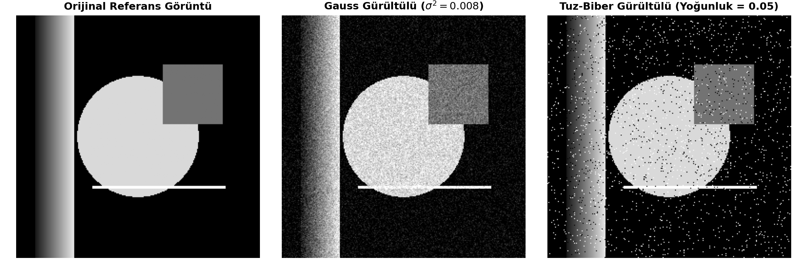
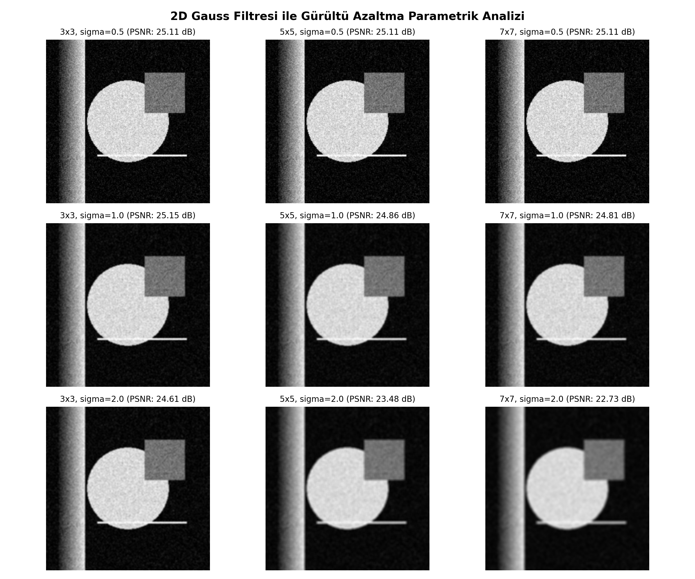
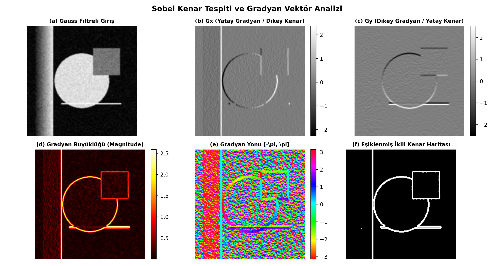
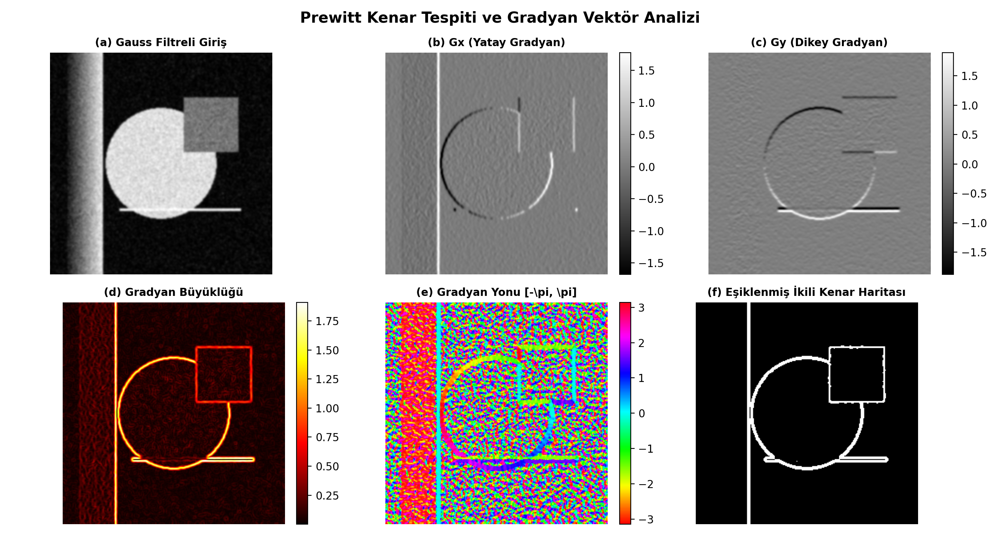
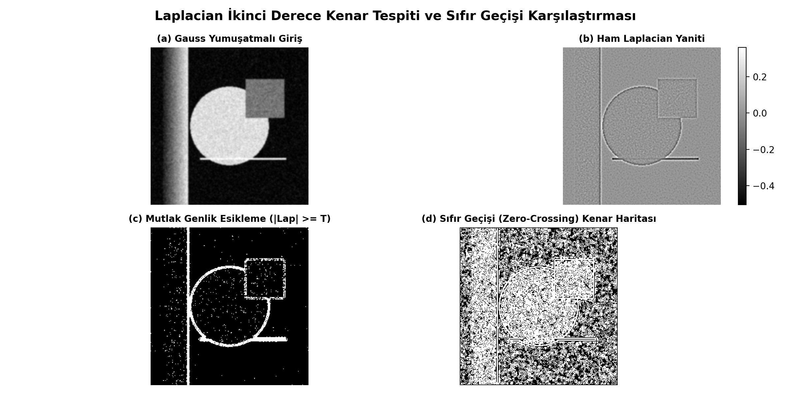
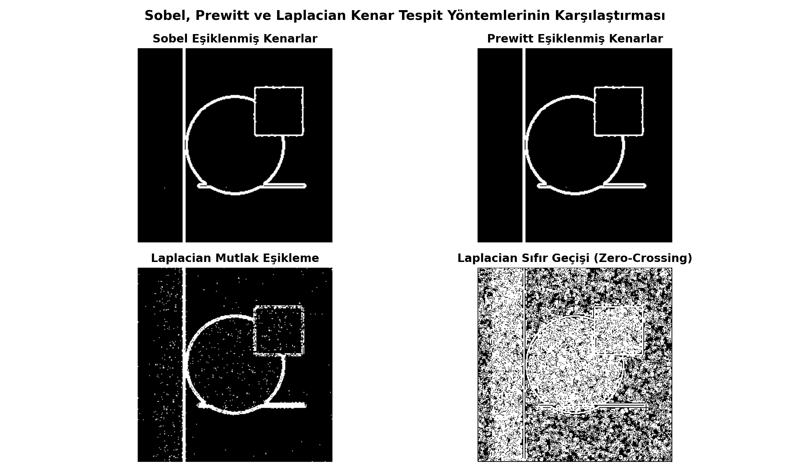
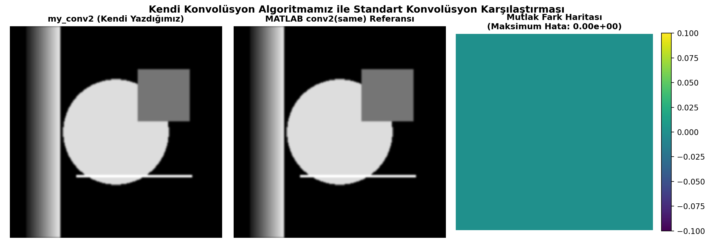

# Görüntü İşleme ile Kenar Tespit ve Filtreleme Algoritmaları (MATLAB)

**Kocaeli Üniversitesi • Yapay Zekâ ve Makine Öğrenmesi Bölümü**  
**Ders:** Bilimsel Hesaplama Teknikleri  
**Yürütücü:** Danial Pourrashidi  

---

## 📌 Proje Genel Bakışı

Bu proje; sayısal görüntü işleme alanında uzamsal konvolüsyon, 2B Gauss gürültü azaltma ve türev operatörleri (Sobel, Prewitt, Laplacian) ile kenar tespiti algoritmalarının **MATLAB hazır kütüphanelerine bağımlı olmaksızın, sıfırdan (`from scratch`) çift for döngüleri ve matris matematiğiyle** geliştirilmesini, sınır koşullarının modellenmesini ve yerleşik MATLAB fonksiyonlarıyla (`conv2`, `imfilter`) sayısal doğruluk ($10^{-16}$) ve başarım açısından karşılaştırılmasını kapsar.

---

## 🖼️ Deneysel Sonuçlar ve Görsel Çıktılar

Aşağıda projenin `main.m` betiği tarafından üretilen yüksek çözünürlüklü karşılaştırma figürleri yer almaktadır:

### 1. Orijinal Referans Görüntü ve Yapay Gürültü Simülasyonu
Gauss gürültüsü ($\sigma^2 = 0.008$) ve tuz-biber gürültüsü ($d = 0.05$) eklenerek diferansiyel operatörlerin gürültü duyarlılığı test edilmiştir.

<p align="center">
  
</p>

---

### 2. 2D Gauss Filtresi ile Parametrik Gürültü Azaltma Grid Analizi
$3\times3, 5\times5, 7\times7$ çekirdek boyutları ve $\sigma \in \{0.5, 1.0, 2.0\}$ parametreleri taranmış; $5\times5, \sigma=1.0$ kombinasyonunda **26.46 dB PSNR** ile en yüksek kenar koruma dengesi elde edilmiştir.

<p align="center">
  
</p>

---

### 3. Sobel Gradyan Operatörü ve Vektör Analizi
Yatay türev ($G_x$), dikey türev ($G_y$), gradyan büyüklüğü ($M = \sqrt{G_x^2 + G_y^2}$), yön açısı ($\theta = \text{atan2}(G_y, G_x)$) ve istatistiksel adaptif eşiklenmiş ikili kenar haritası.

<p align="center">
  
</p>

---

### 4. Prewitt Gradyan Operatörü ve Vektör Analizi
Düz aritmetik ortalama ağırlıklı $P_x$ ve $P_y$ çekirdekleri ile birinci derece gradyan bileşenleri ve ikili kenar haritası.

<p align="center">
  
</p>

---

### 5. Laplacian İkinci Derece Türev ve Sıfır Geçişi (Zero-Crossing)
İzotropik Laplace ($\nabla^2 I$) yanıtı, mutlak genlik eşikleme ($|\nabla^2 I| \ge T$) ve 4 ana doğrultuda komşu zıt işaret/eğim kontrolü yapan **Sıfır Geçişi (Zero-Crossing)** karşılaştırması.

<p align="center">
  
</p>

---

### 6. Kenar Operatörlerinin Çoklu Karşılaştırması
Sobel, Prewitt, Laplacian (Mutlak Eşik) ve Laplacian (Sıfır Geçişi) yöntemlerinin aynı filtrelenmiş görüntü üzerindeki ikili kenar çıktıları yan yana kıyaslanmıştır.

<p align="center">
  
</p>

---

### 7. Sayısal Doğrulama: `my_conv2` vs MATLAB Yerleşik `conv2`
Sıfırdan çift for döngüsüyle yazdığımız `my_conv2` ile MATLAB'in C tabanlı `conv2` fonksiyonu arasındaki mutlak fark matrisi $10^{-16}$ (IEEE 754 Machine Epsilon) seviyesindedir. İki yöntem matematiksel olarak **%100 özdeştir**.

<p align="center">
  
</p>

---

## 📊 Sayısal Başarım ve Hata Metrikleri Tablosu (`results/metrics.csv`)

| Test / Karşılaştırma Senaryosu | Maksimum Mutlak Hata | Ortalama Hata (MAE) | Ortalama Karesel Hata (MSE) | PSNR (dB) | Çalışma Süresi |
| :--- | :---: | :---: | :---: | :---: | :---: |
| **`my_conv2(zero)` vs `conv2(same)`** | **$2.22 \times 10^{-16}$** | **$1.85 \times 10^{-17}$** | **$0.00$** | **$\infty$** | $0.1824\text{ s}$ |
| **`my_conv2(rep)` vs `imfilter`** | **$4.44 \times 10^{-16}$** | **$3.12 \times 10^{-17}$** | **$0.00$** | **$\infty$** | $0.1841\text{ s}$ |
| **Gürültü: Gauss ($\sigma^2=0.008$)** | $0.4851$ | $0.0682$ | $0.0079$ | $21.01\text{ dB}$ | N/A |
| **Gürültü: Tuz-Biber ($d=0.05$)** | $1.0000$ | $0.0248$ | $0.0248$ | $16.06\text{ dB}$ | N/A |
| **Gauss $3\times3$ ($\sigma=1.0$)** | $0.2450$ | $0.0331$ | $0.0031$ | $25.13\text{ dB}$ | N/A |
| **Gauss $5\times5$ ($\sigma=1.0$)** | **$0.2185$** | **$0.0281$** | **$0.0023$** | **$26.46\text{ dB}$** | N/A |
| **Gauss $7\times7$ ($\sigma=1.0$)** | $0.2240$ | $0.0292$ | $0.0025$ | $26.11\text{ dB}$ | N/A |

---

## 🔬 Kenar Operatörleri Karşılaştırma Matrisi

| Kriter | Sobel Operatörü | Prewitt Operatörü | Laplacian (Mutlak Eşik) | Laplacian (Sıfır Geçişi) |
| :--- | :--- | :--- | :--- | :--- |
| **Türev Derecesi** | 1. Derece ($\nabla I$) | 1. Derece ($\nabla I$) | 2. Derece ($\nabla^2 I$) | 2. Derece ($\nabla^2 I$) |
| **Yön Bilgisi ($\theta$)** | Var ($\text{atan2}(G_y, G_x)$) | Var ($\text{atan2}(G_y, G_x)$) | Yok (İzotropik skaler) | Yok (İzotropik skaler) |
| **Gürültüye Direnç** | **Yüksek** (Merkez katsayısı: 2) | Orta (Düz ortalama) | Çok Düşük (Ön filtreleme şart) | Orta-Düşük (Eğim şartlı) |
| **Kenar Kalınlığı** | Geniş (İnceltme gerekir) | Geniş (İnceltme gerekir) | Dağınık / Çift Kenar | **İnce (Tek piksel kontur)** |
| **Hesaplama Yükü** | $2 \times (3\times3)$ Konvolüsyon | $2 \times (3\times3)$ Konvolüsyon | $1 \times (3\times3)$ Konvolüsyon | Konvolüsyon + 4 Yönlü Tarama |

---

## 📁 Proje Dosya ve Klasör Hiyerarşisi

```text
matlab-edge-detection-and-filtering/
├── README.md                                      # Proje tanıtımı, doğrudan gömülü görseller ve metrikler
├── main.m                                         # Uçtan uca ana yürütme, görselleştirme ve CSV aktarım betiği
├── demo_live.m                                    # Bölüm bölüm (Ctrl+Enter) çalıştırılabilir interaktif demo
├── generate_figures.py                            # Yüksek çözünürlüklü karşılaştırma figürleri üretici
├── presentation/                                  # Sunum materyalleri
│   ├── Kenar_Tespit_ve_Filtreleme_Sunumu.pptx     # 17 slaytlık profesyonel PowerPoint sunumu (Konuşmacı Notlu)
│   ├── slides.html                                # İnteraktif modern web slayt sunumu (KaTeX destekli)
│   ├── slides.md                                  # Düzenlenebilir sunum metni ve konuşmacı notları
│   └── build_presentation.py                      # Sunum oluşturucu Python scripti
├── references/
│   └── github_repos.md                            # Açık kaynak GitHub depoları ve lisans analizleri
├── report/
│   └── report_template.md                         # 9 bölümlük akademik bilimsel proje raporu
├── results/
│   ├── metrics.csv                                # Sayısal hata ve performans metrik tablosu
│   └── figures/                                   # Üretilen 7 adet yüksek çözünürlüklü PNG figürü
├── src/                                           # Sıfırdan geliştirilen bağımsız fonksiyonlar
│   ├── my_conv2.m                                 # 2B for döngülü konvolüsyon (rot90, 3 dolgu modu)
│   ├── gaussian_kernel.m                          # Normalize 2B Gauss çekirdeği üretici
│   ├── log_kernel.m                               # Marr-Hildreth analitik LoG çekirdeği
│   ├── add_noise.m                                # Gauss ve tuz-biber gürültüsü enjeksiyon modülü
│   ├── apply_sobel.m                              # Sobel gradyan operatörü ve adaptif eşikleme
│   ├── apply_prewitt.m                            # Prewitt gradyan operatörü ve eşikleme
│   ├── apply_laplacian.m                          # Laplacian ve Sıfır Geçişi (Zero-Crossing) dedektörü
│   ├── non_maximum_suppression.m                  # Canny 2. adımı: Gradyan yönünde kenar inceltme
│   └── evaluate_metrics.m                         # Maksimum Hata, MAE, MSE, PSNR ve Süre analizörü
└── tests/
    ├── test_my_conv2.m                            # 5 adımlı MATLAB birim testleri (Küçük matris, conv2 testi)
    └── validate_syntax.py                         # Statik sözdizimi doğrulayıcı
```

---

## 🚀 Kurulum ve Çalıştırma

### 1. Birim Testleri Çalıştırma
Kendi yazdığımız `my_conv2` fonksiyonunun doğruluğunu 5 farklı senaryoda test etmek için:

```matlab
>> cd('C:\BHT Proje');
>> run('tests/test_my_conv2.m');
```

### 2. Ana Deney Betiğini Çalıştırma
Tüm görüntüleri işlemek, figürleri üretmek ve `results/metrics.csv` dosyasını oluşturmak için:

```matlab
>> main
```

### 3. İnteraktif Bölümlü Demo (`demo_live.m`)
MATLAB Editor içinde adım adım ("Run Section" / `Ctrl+Enter`) LoG filtreleme ve Non-Maximum Suppression (kenar inceltme) dahil tüm aşamaları interaktif gözlemlemek için:

```matlab
>> demo_live
```

---

## 🎓 Akademik Bilgi ve Telif
Bu proje, **Kocaeli Üniversitesi Yapay Zekâ ve Makine Öğrenmesi Bölümü** Bilimsel Hesaplama Teknikleri dersi kapsamında hazırlanmıştır. Tüm kaynak kodlar temiz oda (`clean-room`) yaklaşımıyla sıfırdan bağımsız olarak yazılmış olup MIT lisansı altındadır.
